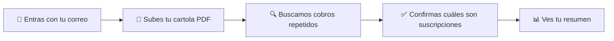
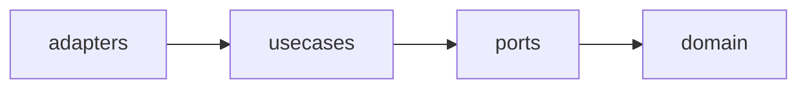

# Fokko Subs

**Descubre en qué te están cobrando cada mes.**

Las suscripciones se cobran en silencio, de a poco, y un día sumas cuatro o cinco que ya ni usas.
Fokko Subs lee tu cartola, encuentra esos cobros que se repiten y te muestra cuánto suman.

> Estado: **en construcción** (MVP). Hoy funciona el motor de detección; la app completa llega pronto.

[Qué hace](#qué-hace) · [Cómo funciona](#cómo-funciona) · [Tus datos](#tus-datos) · [Pruébalo](#pruébalo-en-tu-computadora) · [Para desarrolladores](#para-desarrolladores)

---

## Qué hace

```
Tu cartola                          Fokko Subs
──────────────────────────          ──────────────────────────────────
NETFLIX        $ 9.990              Total del mes      $ 14.980
SPOTIFY        $ 4.990     ──▶      Próximo cobro      en 3 días
SUPERMERCADO   $ 38.120             Alzas de precio    1 (Spotify, +$ 990)
...                                 Cómo cancelar      con enlace directo
```

> Ejemplo ilustrativo, con cifras inventadas.

Con eso ves:

- **Total del mes en pesos.** Los cobros en dólares se convierten con el tipo de cambio de tu
  cartola y se marcan como aproximados.
- **Próximo cobro de cada una**, y cuántos te quedan este mes.
- **Alzas de precio**: cuánto subió, desde cuándo y cuánto te cuesta al año.
- **Cómo cancelar**, con el enlace al sitio del servicio. Decides tú: la app no cancela nada por ti.

## Para quién es

Para quien paga varias suscripciones con la tarjeta y ya no sabe cuáles siguen activas ni cuánto
suman: streaming, música, software, apps, membresías.

## Cómo funciona



1. **Entras con tu correo.** Te enviamos un código de 6 dígitos. Sin contraseña.
2. **Subes tu cartola en PDF.** Hoy leemos las de BCI. La app reconoce el banco y la fecha de
   facturación sola.
3. **Revisas lo que encontramos.** Cada cobro que se repite mes a mes aparece como posible
   suscripción, con la evidencia de cuándo se cobró. Tú confirmas si lo es o no.

## Lo que puedes hacer

- Ponerle nombre a cada una, por si tienes dos del mismo servicio.
- Corregir el monto o el día de cobro cuando la cartola no lo refleja.
- Agregar a mano una que no aparece en tus cartolas.
- Dejar de seguir una: no suma al total y no vuelve a aparecer.
- Marcarla como "por cancelar".
- Deshacer cualquier decisión.

## Tus datos

Tus datos son tuyos y solo los ves tú.

- **Guardamos lo mínimo**: comercio, monto, fecha y los últimos 4 dígitos de la tarjeta.
- **El texto completo de la cartola no se guarda.** Se descarta al terminar de leerla.
- **Te los llevas cuando quieras**: descarga una copia (CSV o JSON) o elimina todo.

## Lo que todavía no hace

- Leer tu correo para detectar compras y avisos de precio antes del cobro.
- Cartolas de otros bancos o en otros formatos (CSV). Hoy solo BCI en PDF.
- Recordatorios antes de cada cobro, notificaciones y calendario.
- Ingresar con Google o Apple.
- Funcionar sin conexión.

---

## Pruébalo en tu computadora

Necesitas Go 1.27 o superior y Git. Nada más: la base de datos (SQLite) viene incluida.

```sh
git clone https://github.com/code-rcplaza/mail-checker.git
cd mail-checker/backend
go build -o mail-checker ./cmd/api
./mail-checker
```

Comprueba que responde:

```sh
curl http://localhost:8080/api/health
# {"status":"ok"}
```

Para detenerlo, `Ctrl+C`.

<details>
<summary><strong>Requisitos y variables de entorno</strong></summary>

| Herramienta | Versión | Para qué |
|---|---|---|
| Go | 1.27 o superior | Compilar y correr el servidor |
| Git | cualquiera | Obtener el código |
| Staticcheck | última | Solo para revisar el código (`go install honnef.co/go/tools/cmd/staticcheck@latest`) |
| sqlc | v1.31.1 | No se instala: `go run github.com/sqlc-dev/sqlc/cmd/sqlc@v1.31.1 generate` regenera las consultas y `diff` comprueba que estén al día; el código generado ya viene en el repo |
| Node.js | 24 o superior | Herramientas del front |
| pnpm | 10 o superior | Instalar y correr el front (`pnpm install` dentro de `frontend/`) |

Docker todavía no está listo.

| Variable | Por defecto | Qué hace |
|---|---|---|
| `MAILCHECKER_PORT` | `8080` | Puerto del servidor, entre 1 y 65535 |
| `MAILCHECKER_DB_PATH` | `data/mail-checker.db` | Archivo de la base de datos; la carpeta se crea sola |
| `MAILCHECKER_ENV` | `development` | `development` o `production` |
| `MAILCHECKER_RESEND_API_KEY` | — | Llave de Resend para enviar los códigos; obligatoria en `production`. En `development`, sin llave, el código se escribe en la consola |
| `MAILCHECKER_MAIL_FROM` | — | Remitente de los códigos (dominio verificado en Resend); obligatorio en `production` |

Un valor inválido hace que el programa se detenga con un mensaje claro en lugar de arrancar a medias.

</details>

<details>
<summary><strong>Correr las pruebas</strong></summary>

Backend, desde `backend/`:

```sh
go test -count=1 -timeout 60s ./...
```

Frontend, desde `frontend/`:

```sh
pnpm install
pnpm test        # pruebas (Vitest + Testing Library)
pnpm lint        # Biome: lint y formato
pnpm typecheck   # TypeScript estricto
```

Para desarrollar el front: con el servidor de Go corriendo en `:8080`, `pnpm dev` abre Vite en
`http://localhost:5173` y le pasa `/api` al servidor. `pnpm build` deja el sitio dentro del backend
(`backend/internal/shared/httpserver/web/dist`), para que Go lo sirva en un solo binario.

</details>

> **Todavía no puedes usar el producto completo desde aquí.** La API ya responde (registro con código,
> subir cartola, resumen, acciones sobre suscripciones, copia de tus datos y eliminar la cuenta), pero
> las pantallas del front están en construcción.

---

## Para desarrolladores

Todo lo técnico está abajo, plegado para que no estorbe. El diseño completo vive en
[`docs/ARCHITECTURE.md`](docs/ARCHITECTURE.md), que es la fuente de verdad. Lo que entra en la
primera versión está en [`docs/mvp.md`](docs/mvp.md).

<details>
<summary><strong>Stack</strong></summary>

| Parte | Tecnología |
|---|---|
| Backend | Go (módulo `github.com/code-rcplaza/mail-checker/backend`, Go 1.27) |
| Router HTTP | `github.com/go-chi/chi/v5` |
| Base de datos | SQLite (`modernc.org/sqlite`, sin cgo), migraciones con `github.com/pressly/goose/v3` |
| Lectura de PDF | `github.com/ledongthuc/pdf` |
| Frontend | React 19 + TypeScript (estricto) con Vite, Tailwind v4, Biome, Vitest + Testing Library; TanStack Router y Query, react-hook-form + zod (cuando lleguen sus pantallas) |
| Despliegue | Docker (pendiente) |

Las dependencias listadas están aprobadas. Agregar una nueva requiere preguntar antes.

</details>

<details>
<summary><strong>Arquitectura: quién es, qué hace y con qué se conecta</strong></summary>

Cada feature del backend se parte en cuatro capas, y cada una responde una pregunta distinta:

| Capa | Pregunta que responde | Qué contiene | Ejemplo |
|---|---|---|---|
| `domain` | **¿Qué es?** | Las cosas del negocio y sus reglas. Funciones puras, sin base de datos, sin red, sin reloj | `Charge`, `Subscription`, la regla de ±25 % |
| `usecases` | **¿Qué hace?** | La receta de cada acción, paso a paso, llamando a `domain` y a los puertos | `ImportStatement`, `GetSummary` |
| `ports` | **¿Qué necesita del exterior?** | Interfaces que describen lo que hace falta (guardar, leer un PDF, enviar un código) | `StatementRepository`, `FileExtractor` |
| `adapters` | **¿Con qué se conecta?** | Implementaciones concretas de los puertos | SQLite, lector de PDF, HTTP |



Las flechas son dependencias: cada capa solo conoce a las que están a su derecha. Por eso
`domain` puede probarse sin base de datos, y cambiar SQLite o el lector de PDF no toca las reglas.

Dos reglas que lo sostienen:

- `domain` y `usecases` no importan ninguna librería de infraestructura (ni `adapters`).
- Una feature no importa a otra; si necesita datos de otra, pasa por un adaptador puente.

El detalle completo (puertos por feature, flujos numerados y modelo de datos) está en
[`docs/ARCHITECTURE.md`](docs/ARCHITECTURE.md).

</details>

<details>
<summary><strong>Frontend: capas y componentes (en construcción)</strong></summary>

El front sigue la misma idea que el back: cada feature se parte en capas, y las dependencias apuntan
hacia adentro (`presentation → application → domain`; `infrastructure → application`).

| Capa | Pregunta que responde | Qué contiene |
|---|---|---|
| `domain` | **¿Qué es?** | Tipos `readonly`, funciones puras y schemas de zod. Sin React ni red |
| `application` | **¿Qué hace?** | Hooks de caso de uso (`useSummary`, `useRegister`) y los puertos (gateways) |
| `infrastructure` | **¿Con qué se conecta?** | Implementa los puertos con `lib/api` y convierte la respuesta del servidor a dominio |
| `presentation` | **¿Qué se ve?** | Componentes y pantallas |

Dentro de `presentation` hay dos tipos de pieza, y la diferencia es lo más importante:

- **Componentes presentacionales.** Reciben datos y callbacks por props, y pintan. No llaman a
  `useQuery`, ni al router, ni a `fetch`. Con las mismas props siempre pintan lo mismo, así que se
  prueban sin servidor.
- **Contenedores (`screens`).** Son el único lugar que llama a los hooks de `application` y le pasa
  los datos a los componentes. Sin lógica dentro del JSX.

Otras reglas:

- **Datos del servidor solo en TanStack Query.** Nada de estado global duplicado (sin Redux ni Zustand).
- **Puertos por Context.** `GatewaysProvider` entrega las implementaciones reales; en las pruebas se
  usan dobles en memoria.
- **Un límite roto rompe el lint.** Biome no deja que una carpeta importe lo que no debe.
- **Mobile first.** Diseño base para ~390 px; desde 1024 px (`lg:`) aparece la barra lateral.
- **Atomic Design.** Los componentes de base van en `components/ui/` por nivel: `atoms` (Button,
  Input, Badge…), `molecules` (FormField, ListRow, Card…) y `organisms`. Los templates son
  `components/layout` y las páginas, los contenedores de `screens`.
- **Solo colores semánticos.** `src/styles/tokens.css` tiene dos capas: *raw* (la paleta de Fokko,
  12 pasos por color en claro y oscuro) y *semantic* (para qué es el color: `page`, `ink`, `primary`,
  `danger`…). Tailwind solo conoce los semánticos (`bg-page`, `text-ink`) y un test falla si aparece
  un color raw, un hex o la paleta por defecto fuera de ese archivo.

El detalle (carpetas, tokens de color, navegación) está en
[`docs/ARCHITECTURE.md`](docs/ARCHITECTURE.md#frontend).

</details>

<details>
<summary><strong>Estructura del backend</strong></summary>

```
backend/
├── cmd/api/            Punto de entrada: config, arranque y apagado limpio
└── internal/
    ├── shared/         Dinero, monedas, cargos, errores con llave i18n, SQLite, HTTP, reloj
    ├── accounts/       Cuentas de correo y sus credenciales cifradas (post-MVP)
    ├── emailsync/      Sincronización de correos de compra (post-MVP)
    ├── statements/     Cartolas: extracción de texto, parser de BCI, importación
    └── subscriptions/  Detección, resumen, decisiones y ajustes por usuario
```

Cada feature sigue la misma forma:

```
internal/<feature>/
├── domain/      Reglas puras; sin infraestructura
├── ports/       Interfaces que la feature necesita del exterior
├── usecases/    Casos de uso: orquestan puertos y dominio
└── adapters/    Implementaciones concretas (SQLite, PDF, parsers de banco, HTTP)
```

Reglas de dependencia:

- `domain` y `usecases` no importan `adapters` ni infraestructura.
- Una feature no importa a otra; si necesita datos de otra, lo hace desde un adaptador puente
  (por ejemplo `emailsync/adapters/accounts`).
- `cmd/api` es la raíz de composición: arma las dependencias y no tiene lógica.

</details>

<details>
<summary><strong>Convenciones</strong></summary>

- **Usuario en cada operación.** Todo dato es de un usuario. Los puertos de lectura y escritura
  reciben `userID` justo después de `ctx`, y cada consulta filtra por él.
- **Montos en centésimas**, como `shared.Money` (int64). Nunca floats. CLP 5.990 = `599000`.
- **Fechas:** unix en segundos, UTC, en la base y en la API. `time.Time` dentro de Go; la
  conversión vive solo en los adaptadores.
- **El tiempo se inyecta** (`now func() time.Time`). Nada de `time.Now()` en `domain` ni `usecases`.
- **Errores con contexto:** `fmt.Errorf("accion: %w", err)`. Nunca `panic` en flujo normal, nunca
  un error tragado.
- **Mensajes al usuario:** el backend devuelve llaves i18n (`feature.motivo`), no texto. Las
  llaves son constantes en `domain`. Los logs sí van en texto, con `slog`.
- **Sin datos personales en logs, fixtures ni commits.** Los PDFs reales no entran al repositorio;
  los fixtures son texto anonimizado escrito a mano.
- **Inmutabilidad:** las funciones no modifican slices ni mapas recibidos; devuelven copias.
- **Validación en el borde:** los constructores de `domain` (`NewCharge`, `NewService`,
  `NewManualSubscription`, `NewLineOverride`) validan y devuelven error. No existen valores de
  dominio inválidos.
- **Configuración:** variables de entorno leídas una vez al arrancar. Un valor inválido detiene la
  app con un error explícito.

</details>

<details>
<summary><strong>Base de datos</strong></summary>

- SQLite con `journal_mode=WAL`, `foreign_keys=ON`, `busy_timeout` y `synchronous=FULL`. Un solo escritor.
- Cada migración de goose corre en una transacción. La base (`00001_baseline.sql`) no crea tablas;
  cada feature agrega las suyas desde la `00002`.
- Las transacciones viven dentro de los métodos de los repositorios. Los casos de uso no las manejan.
- Dentro de una transacción solo se usa `tx`, nunca el repositorio ni `db`: la base tiene una sola
  conexión y usar `db` ahí se bloquea.
- Las escrituras son idempotentes (`UNIQUE` + `INSERT … ON CONFLICT DO NOTHING`): importar o
  sincronizar dos veces no duplica datos.
- Cada tabla con datos de usuario lleva `user_id` con `ON DELETE CASCADE`.

</details>

<details>
<summary><strong>Lectura de cartolas</strong></summary>

1. `PDFExtractor` lee el texto del PDF. Las letras de los bancos vienen una por una y sin ancho,
   así que palabras y columnas se reconstruyen por posición. Un PDF dañado devuelve error; un
   `panic` de la librería se convierte en error.
2. Cada parser de banco reconoce su cartola (`Detect`), devuelve sus compras con el número de
   línea (`Parse`), la fecha de facturación (`BillingDate`) y, si existe, el par de traspasos
   (`TransferPair`) que da el tipo de cambio.
3. `ImportStatement` elige el banco (el indicado o el único que lo reconoce), toma la fecha del
   archivo o la del usuario, guarda el tipo de cambio derivado y la cartola con sus cargos.

La cartola de BCI tiene dos estados: el nacional (compras en pesos) y el internacional (origen y
US$). Un cobro en pesos dentro del internacional se reconoce por la razón entre ambos montos.

</details>

<details>
<summary><strong>Pruebas y verificación</strong></summary>

- **Dominio y casos de uso:** tests de tabla con dobles en memoria. Una prueba por criterio.
- **Parsers:** textos anonimizados en `testdata/`, con una prueba de tabla por caso.
- **Repositorios:** contra una base SQLite temporal real, con `-timeout 60s`: un bloqueo debe
  fallar en un minuto, no en diez.
- Solo la biblioteca estándar `testing`, sin testify.
- Un bug se reproduce con un test antes de corregirlo.

Desde `backend/`:

```sh
go build ./...
go vet ./...
staticcheck ./...        # instalado en $(go env GOPATH)/bin
gofmt -l .               # no debe listar nada
go test -count=1 -timeout 60s ./...
```

Algo está listo solo cuando build, vet, staticcheck, gofmt y los tests pasan con la salida a la vista.

</details>

<details>
<summary><strong>Flujo de trabajo</strong></summary>

El backlog vive en `docs/backlog/`: cada idea es `FOKKO-XXXX-SUBS-slug/` con su `idea.md` y una
tarea por archivo `TASK-XXX-NOMBRE.md`. El orden es `/idea` → `/stories` → `/story`, con TDD: plan,
rojo, verde, refactor y verificación. La rama de trabajo es `dev`; `main` es producción y nunca
recibe commits directos.

Los commits van en inglés e identifican la tarea (`FOKKO-XXXX-SUBS/TASK-XXX`) en el cuerpo.

</details>

<details>
<summary><strong>Estado técnico</strong></summary>

**Hecho:** dominio y casos de uso del MVP (catálogo de servicios, detección, cartolas de BCI, tipo
de cambio, resumen, manuales, alzas, ajustes por línea y decisiones del usuario), acceso con código
por correo, persistencia en SQLite, la API REST completa con pruebas de humo, y la base del front
(proyecto, tokens, tema, cliente de la API, i18n y los primeros componentes).

**Pendiente:** el resto de los componentes y las pantallas del front, servir el front desde Go y el
empaquetado en Docker. El avance exacto está en
[`docs/backlog/README.md`](docs/backlog/README.md).

</details>

---

<sub>En construcción. El MVP todavía no tiene fecha pública de lanzamiento.</sub>
